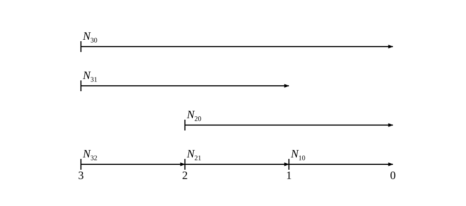
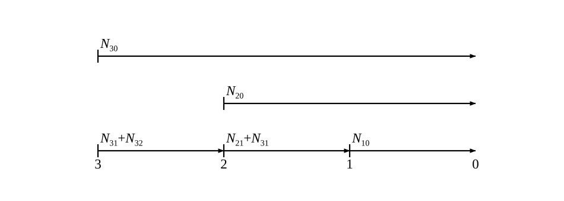
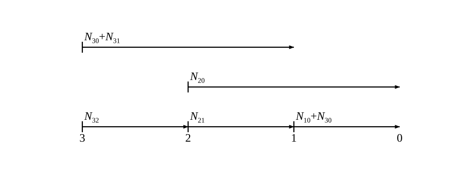
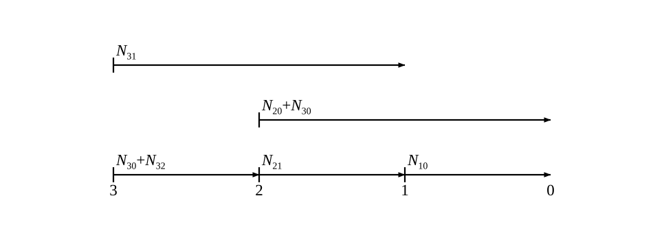
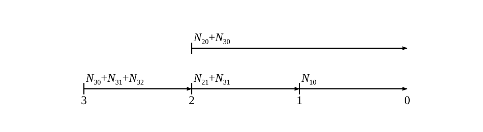
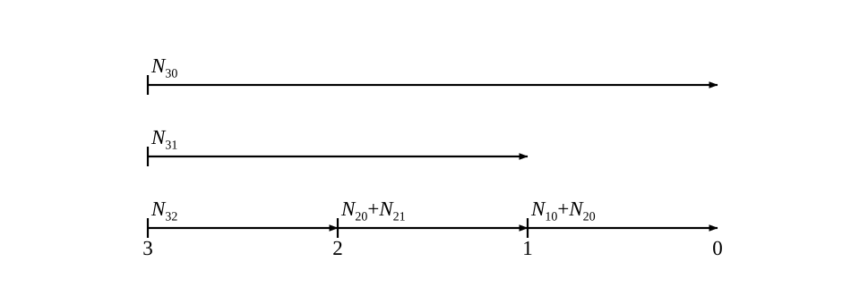
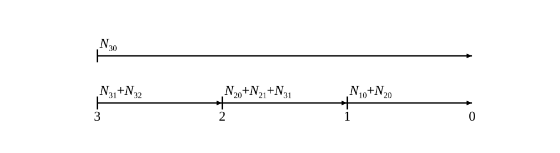
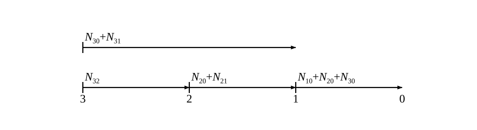
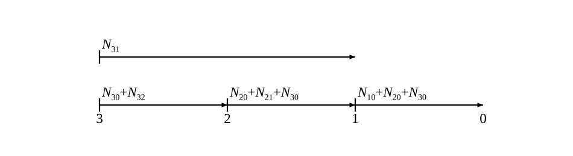
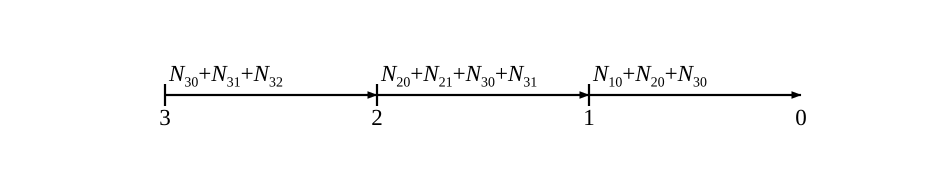

# 算例集（第十一章）

## 第十一章 技术站列车编组计划的编制

### 例 11.3
用绝对计算法确定 ${A}_{3} - {A}_{0}$ 方向单组列车编组计划最优方案,并绘制列车到达站图, 资料如图 11.10 所示 (各站改编能力不受限制)。
<table>
<tr><td></td><td>$A_3$</td><td>$A_2$</td><td>$A_1$</td><td>$A_0$</td></tr>
<tr><td>$T_集$</td><td>500</td><td>600</td></tr>
<tr><td>$t_节$</td><td></td><td>4</td><td>3</td></tr>
</table>
<table>
<tr><td>—</td></tr>
<tr><td>120</td><td>—</td></tr>
<tr><td>100</td><td>80</td><td>—</td></tr>
</table>
图 11.10 例 11.3 计算资料

#### 绝对计算法
根据车流梯形图可知，
$N_{31}=120,N_{30}=100,N_{20}=80$

**第一步，枚举所有方案，画出列车到站图。**   
**第二步，列出绝对计算法表格，明确非短途直达车流的量，根据到站图填写直达车流无改编通过的量为0，剩余为车流量，并计算目标函数值。**   
方案1
 
 <table><tr><td></td><td>$A_3$</td><td>$A_2$</td><td>$A_1$</td><td>$A_0$</td></tr>
<tr><td>$T_集$</td><td>500</td><td>600</td></tr>
<tr><td>$t_节$</td><td>—</td><td>4</td><td>3</td></tr>
<tr><td colspan='2'>$N_{31}=120$</td><td>0</td></tr>
<tr><td colspan='2'>$N_{30}=100$</td><td>0</td><td>0</td></tr>
<tr><td colspan='2'>$N_{20}=80$</td><td>—</td><td>0</td></tr>
<tr><td colspan='2'>$N_{改编}$</td><td>0</td><td>0</td></tr>
<tr><td colspan='2'>$N_{改编}t_节$</td><td>0</td><td>0</td><td>0</td></tr>
<tr><td colspan='2'>$T_集^3=500$</td><td colspan='2'>$K_3=2$</td><td>1000</td></tr>
<tr><td colspan='2'>$T_集^2=600$</td><td colspan='2'>$K_2=1$</td><td>600</td></tr>
<tr><td colspan='4'>$F_耗$</td><td>0+1000+600=1600</td></tr>
</table>

方案2
 
 <table><tr><td></td><td>$A_3$</td><td>$A_2$</td><td>$A_1$</td><td>$A_0$</td></tr>
<tr><td>$T_集$</td><td>500</td><td>600</td></tr>
<tr><td>$t_节$</td><td>—</td><td>4</td><td>3</td></tr>
<tr><td colspan='2'>$N_{31}=120$</td><td>120</td></tr>
<tr><td colspan='2'>$N_{30}=100$</td><td>0</td><td>0</td></tr>
<tr><td colspan='2'>$N_{20}=80$</td><td>—</td><td>0</td></tr>
<tr><td colspan='2'>$N_{改编}$</td><td>120</td><td>0</td></tr>
<tr><td colspan='2'>$N_{改编}t_节$</td><td>480</td><td>0</td><td>480</td></tr>
<tr><td colspan='2'>$T_集^3=500$</td><td colspan='2'>$K_3=1$</td><td>500</td></tr>
<tr><td colspan='2'>$T_集^2=600$</td><td colspan='2'>$K_2=1$</td><td>600</td></tr>
<tr><td colspan='4'>$F_耗$</td><td>480+500+600=1580</td></tr>
</table>

方案3
 
 <table><tr><td></td><td>$A_3$</td><td>$A_2$</td><td>$A_1$</td><td>$A_0$</td></tr>
<tr><td>$T_集$</td><td>500</td><td>600</td></tr>
<tr><td>$t_节$</td><td>—</td><td>4</td><td>3</td></tr>
<tr><td colspan='2'>$N_{31}=120$</td><td>0</td></tr>
<tr><td colspan='2'>$N_{30}=100$</td><td>0</td><td>100</td></tr>
<tr><td colspan='2'>$N_{20}=80$</td><td>—</td><td>0</td></tr>
<tr><td colspan='2'>$N_{改编}$</td><td>0</td><td>100</td></tr>
<tr><td colspan='2'>$N_{改编}t_节$</td><td>0</td><td>300</td><td>300</td></tr>
<tr><td colspan='2'>$T_集^3=500$</td><td colspan='2'>$K_3=1$</td><td>500</td></tr>
<tr><td colspan='2'>$T_集^2=600$</td><td colspan='2'>$K_2=1$</td><td>600</td></tr>
<tr><td colspan='4'>$F_耗$</td><td>300+500+600=1400</td></tr>
</table>

方案4
 
 <table><tr><td></td><td>$A_3$</td><td>$A_2$</td><td>$A_1$</td><td>$A_0$</td></tr>
<tr><td>$T_集$</td><td>500</td><td>600</td></tr>
<tr><td>$t_节$</td><td>—</td><td>4</td><td>3</td></tr>
<tr><td colspan='2'>$N_{31}=120$</td><td>0</td></tr>
<tr><td colspan='2'>$N_{30}=100$</td><td>100</td><td>0</td></tr>
<tr><td colspan='2'>$N_{20}=80$</td><td>—</td><td>0</td></tr>
<tr><td colspan='2'>$N_{改编}$</td><td>100</td><td>0</td></tr>
<tr><td colspan='2'>$N_{改编}t_节$</td><td>400</td><td>0</td><td>400</td></tr>
<tr><td colspan='2'>$T_集^3=500$</td><td colspan='2'>$K_3=1$</td><td>500</td></tr>
<tr><td colspan='2'>$T_集^2=600$</td><td colspan='2'>$K_2=1$</td><td>600</td></tr>
<tr><td colspan='4'>$F_耗$</td><td>400+500+600=1500</td></tr>
</table>

方案5
 
 <table><tr><td></td><td>$A_3$</td><td>$A_2$</td><td>$A_1$</td><td>$A_0$</td></tr>
<tr><td>$T_集$</td><td>500</td><td>600</td></tr>
<tr><td>$t_节$</td><td>—</td><td>4</td><td>3</td></tr>
<tr><td colspan='2'>$N_{31}=120$</td><td>120</td></tr>
<tr><td colspan='2'>$N_{30}=100$</td><td>100</td><td>0</td></tr>
<tr><td colspan='2'>$N_{20}=80$</td><td>—</td><td>0</td></tr>
<tr><td colspan='2'>$N_{改编}$</td><td>220</td><td>0</td></tr>
<tr><td colspan='2'>$N_{改编}t_节$</td><td>880</td><td>0</td><td>880</td></tr>
<tr><td colspan='2'>$T_集^3=500$</td><td colspan='2'>$K_3=0$</td><td>0</td></tr>
<tr><td colspan='2'>$T_集^2=600$</td><td colspan='2'>$K_2=1$</td><td>600</td></tr>
<tr><td colspan='4'>$F_耗$</td><td>880+0+600=1480</td></tr>
</table>

方案6
 
 <table><tr><td></td><td>$A_3$</td><td>$A_2$</td><td>$A_1$</td><td>$A_0$</td></tr>
<tr><td>$T_集$</td><td>500</td><td>600</td></tr>
<tr><td>$t_节$</td><td>—</td><td>4</td><td>3</td></tr>
<tr><td colspan='2'>$N_{31}=120$</td><td>0</td></tr>
<tr><td colspan='2'>$N_{30}=100$</td><td>0</td><td>0</td></tr>
<tr><td colspan='2'>$N_{20}=80$</td><td>—</td><td>80</td></tr>
<tr><td colspan='2'>$N_{改编}$</td><td>0</td><td>80</td></tr>
<tr><td colspan='2'>$N_{改编}t_节$</td><td>0</td><td>240</td><td>240</td></tr>
<tr><td colspan='2'>$T_集^3=500$</td><td colspan='2'>$K_3=2$</td><td>1000</td></tr>
<tr><td colspan='2'>$T_集^2=600$</td><td colspan='2'>$K_2=0$</td><td>0</td></tr>
<tr><td colspan='4'>$F_耗$</td><td>240+1000+0=1240</td></tr>
</table>

方案7
 
 <table><tr><td></td><td>$A_3$</td><td>$A_2$</td><td>$A_1$</td><td>$A_0$</td></tr>
<tr><td>$T_集$</td><td>500</td><td>600</td></tr>
<tr><td>$t_节$</td><td>—</td><td>4</td><td>3</td></tr>
<tr><td colspan='2'>$N_{31}=120$</td><td>120</td></tr>
<tr><td colspan='2'>$N_{30}=100$</td><td>0</td><td>0</td></tr>
<tr><td colspan='2'>$N_{20}=80$</td><td>—</td><td>80</td></tr>
<tr><td colspan='2'>$N_{改编}$</td><td>120</td><td>80</td></tr>
<tr><td colspan='2'>$N_{改编}t_节$</td><td>480</td><td>240</td><td>720</td></tr>
<tr><td colspan='2'>$T_集^3=500$</td><td colspan='2'>$K_3=1$</td><td>500</td></tr>
<tr><td colspan='2'>$T_集^2=600$</td><td colspan='2'>$K_2=0$</td><td>0</td></tr>
<tr><td colspan='4'>$F_耗$</td><td>720+500+0=1220</td></tr>
</table>

方案8
 
 <table><tr><td></td><td>$A_3$</td><td>$A_2$</td><td>$A_1$</td><td>$A_0$</td></tr>
<tr><td>$T_集$</td><td>500</td><td>600</td></tr>
<tr><td>$t_节$</td><td>—</td><td>4</td><td>3</td></tr>
<tr><td colspan='2'>$N_{31}=120$</td><td>0</td></tr>
<tr><td colspan='2'>$N_{30}=100$</td><td>0</td><td>100</td></tr>
<tr><td colspan='2'>$N_{20}=80$</td><td>—</td><td>80</td></tr>
<tr><td colspan='2'>$N_{改编}$</td><td>0</td><td>180</td></tr>
<tr><td colspan='2'>$N_{改编}t_节$</td><td>0</td><td>540</td><td>540</td></tr>
<tr><td colspan='2'>$T_集^3=500$</td><td colspan='2'>$K_3=1$</td><td>500</td></tr>
<tr><td colspan='2'>$T_集^2=600$</td><td colspan='2'>$K_2=0$</td><td>0</td></tr>
<tr><td colspan='4'>$F_耗$</td><td>540+500+0=1040</td></tr>
</table>

方案9
 
 <table><tr><td></td><td>$A_3$</td><td>$A_2$</td><td>$A_1$</td><td>$A_0$</td></tr>
<tr><td>$T_集$</td><td>500</td><td>600</td></tr>
<tr><td>$t_节$</td><td>—</td><td>4</td><td>3</td></tr>
<tr><td colspan='2'>$N_{31}=120$</td><td>0</td></tr>
<tr><td colspan='2'>$N_{30}=100$</td><td>100</td><td>100</td></tr>
<tr><td colspan='2'>$N_{20}=80$</td><td>—</td><td>80</td></tr>
<tr><td colspan='2'>$N_{改编}$</td><td>100</td><td>180</td></tr>
<tr><td colspan='2'>$N_{改编}t_节$</td><td>400</td><td>540</td><td>940</td></tr>
<tr><td colspan='2'>$T_集^3=500$</td><td colspan='2'>$K_3=1$</td><td>500</td></tr>
<tr><td colspan='2'>$T_集^2=600$</td><td colspan='2'>$K_2=0$</td><td>0</td></tr>
<tr><td colspan='4'>$F_耗$</td><td>940+500+0=1440</td></tr>
</table>

方案10
 
 <table><tr><td></td><td>$A_3$</td><td>$A_2$</td><td>$A_1$</td><td>$A_0$</td></tr>
<tr><td>$T_集$</td><td>500</td><td>600</td></tr>
<tr><td>$t_节$</td><td>—</td><td>4</td><td>3</td></tr>
<tr><td colspan='2'>$N_{31}=120$</td><td>120</td></tr>
<tr><td colspan='2'>$N_{30}=100$</td><td>100</td><td>100</td></tr>
<tr><td colspan='2'>$N_{20}=80$</td><td>—</td><td>80</td></tr>
<tr><td colspan='2'>$N_{改编}$</td><td>220</td><td>180</td></tr>
<tr><td colspan='2'>$N_{改编}t_节$</td><td>880</td><td>540</td><td>1420</td></tr>
<tr><td colspan='2'>$T_集^3=500$</td><td colspan='2'>$K_3=0$</td><td>0</td></tr>
<tr><td colspan='2'>$T_集^2=600$</td><td colspan='2'>$K_2=0$</td><td>0</td></tr>
<tr><td colspan='4'>$F_耗$</td><td>1420+0+0=1420</td></tr>
</table>

**第三步，找到车小时消耗最小的方案。**  
综上，方案8车小时消耗最小，为1040车小时，为最佳方案。

#### 表格计算法
**第 1 步,根据车流量计算所有的 ${N}_{\text{ 通 }}{t}_{\text{ 节 }}$ 值,并填入表格计算法计算表格内。**
<table>
<tr><td></td><td>$A_3$</td><td>$A_2$</td><td>$A_1$</td><td>$A_0$</td></tr>
<tr><td>$T_集$</td><td>500</td><td>600</td></tr>
<tr><td>$t_节$</td><td></td><td>4</td><td>3</td></tr>
<tr><td colspan='2'>$N_{31}=120$</td><td>480</td></tr>
<tr><td colspan='2'>$N_{30}=100$</td><td>400</td><td>300</td></tr>
<tr><td colspan='2'>$N_{20}=80$</td><td>—</td><td>240</td></tr>
</table>

**第 2 步, 计算绝对条件、必要条件2条，确定初始方案，并计算目标函数值。**

(1)绝对条件的判断：    
$N_{31}$是否满足绝对条件:  
$N_{31}t_节^2=120*4=480<T_集^3=500$，不满足；  
$N_{30}$是否满足绝对条件:  
$N_{30}t_节^1=100*3=300<T_集^3=500$，不满足；  
$N_{20}$是否满足绝对条件:  
$N_{20}t_节^1=80*3=240<T_集^2=600$，不满足；  

(2)必要条件1的判断：   
$N_{30}$是否满足必要条件:   
$N_{30}(t_节^2+t_节^1)=100*7=700>T_集^3=500$，满足；  

(3)必要条件2的判断
对其余车流，$N_{31}$和$N_{20}$考虑相互合并，实际是无法合并的，形成不了非短途直达列流。

至此, 初始方案确定完毕, 初始方案是直达列车到达站数最多的方案。
<table>
<tr><td></td><td>$A_3$</td><td>$A_2$</td><td>$A_1$</td><td>$A_0$</td></tr>
<tr><td>$T_集$</td><td>500</td><td>600</td></tr>
<tr><td>$t_节$</td><td></td><td>4</td><td>3</td></tr>
<tr><td colspan='2'>$N_{31}=120$</td><td>480</td></tr>
<tr><td colspan='2'>$N_{30}=100$</td><td>400 $\bigcirc$ </td><td>300 $\bigcirc$ </td></tr>
<tr><td colspan='2'>$N_{20}=80$</td><td>—</td><td>240</td></tr>
</table>
初始方案为绝对计算法中的方案7  
 
 目标函数值为表格中所有记号的数据加和减去方案中所有开行的直达车流在始发站集结总时间消耗。  
 $F_节^{初始}=400+300-500=200$  
 经绝对计算法的数据验证，$F_耗^{方案10}-F_耗^{方案7}=1420-1220=200=F_节^{初始}$。
 
**第 3 步，调整初始方案，使用绝对条件验证方案可行性，做出计算表格和列车到站图，然后比较所有调整方案目标函数值。**

调整方案1：压缩$N_{30}$的到站，$N_{31}$和$N_{30}$合并开行。  
经验证，300<500，不满足绝对条件，可以合并。
<table>
<tr><td></td><td>$A_3$</td><td>$A_2$</td><td>$A_1$</td><td>$A_0$</td></tr>
<tr><td>$T_集$</td><td>500</td><td>600</td></tr>
<tr><td>$t_节$</td><td></td><td>4</td><td>3</td></tr>
<tr><td colspan='2'>$N_{31}=120$</td><td>480 $\bigcirc$ </td></tr>
<tr><td colspan='2'>$N_{30}=100$</td><td>400 $\bigcirc$ </td><td>300</td></tr>
<tr><td colspan='2'>$N_{20}=80$</td><td>—</td><td>240</td></tr>
</table>
初始方案为绝对计算法中的方案8  
   
 $F_节^{调整1}=480+400-500=380$  
 经绝对计算法的数据验证，$F_耗^{方案10}-F_耗^{方案8}=1420-1040=380=F_节^{调整1}$。

调整方案2：压缩$N_{30}$的发站，$N_{30}$和$N_{20}$合并开行。  
经验证，400<600，不满足绝对条件，可以合并。
<table>
<tr><td></td><td>$A_3$</td><td>$A_2$</td><td>$A_1$</td><td>$A_0$</td></tr>
<tr><td>$T_集$</td><td>500</td><td>600</td></tr>
<tr><td>$t_节$</td><td></td><td>4</td><td>3</td></tr>
<tr><td colspan='2'>$N_{31}=120$</td><td>480</td></tr>
<tr><td colspan='2'>$N_{30}=100$</td><td>400</td><td>300 $\bigcirc$ </td></tr>
<tr><td colspan='2'>$N_{20}=80$</td><td>—</td><td>240 $\bigcirc$ </td></tr>
</table>
初始方案为绝对计算法中的方案5  
   
 $F_节^{调整2}=300+240-600=-60$  
 经绝对计算法的数据验证，$F_耗^{方案10}-F_耗^{方案5}=1420-1480=-60=F_节^{调整2}$。

**第 4 步, 比较目标函数值, 确定最佳方案。**  
调整方案1的目标函数值最大，为最佳方案，$N_{31}$和$N_{30}$合并开行。

