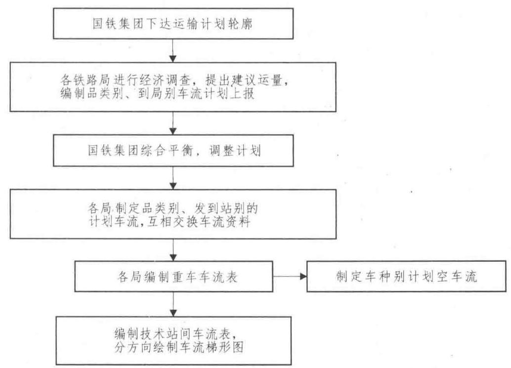
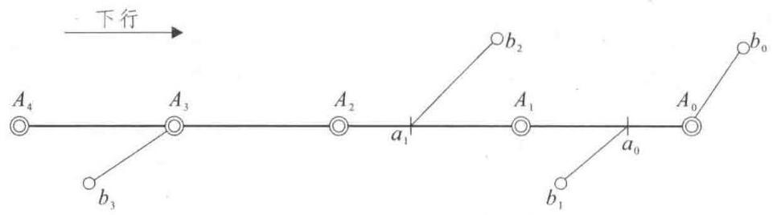
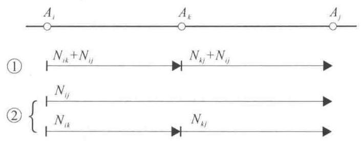
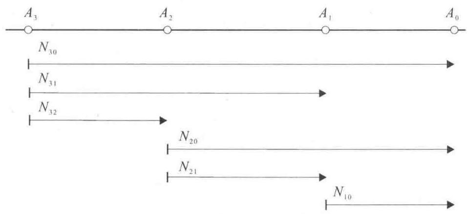
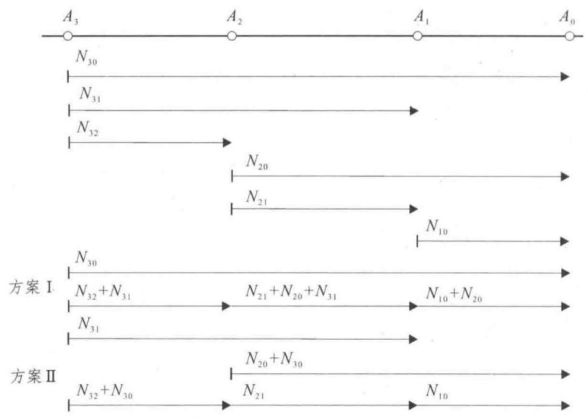
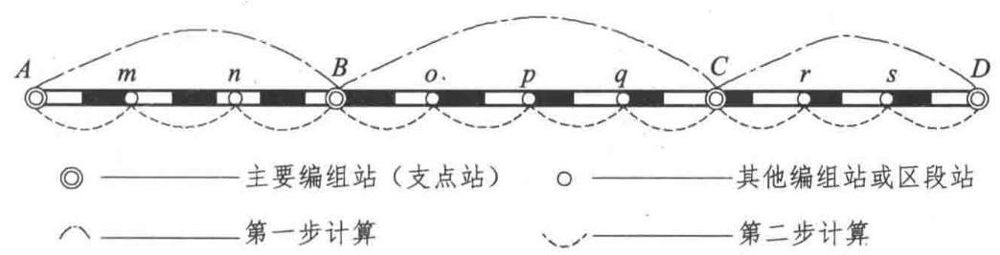
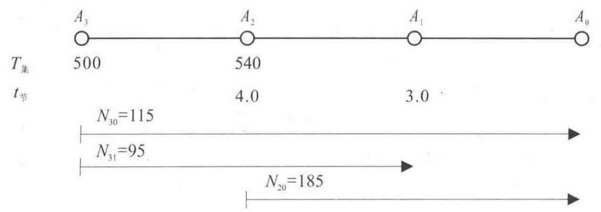
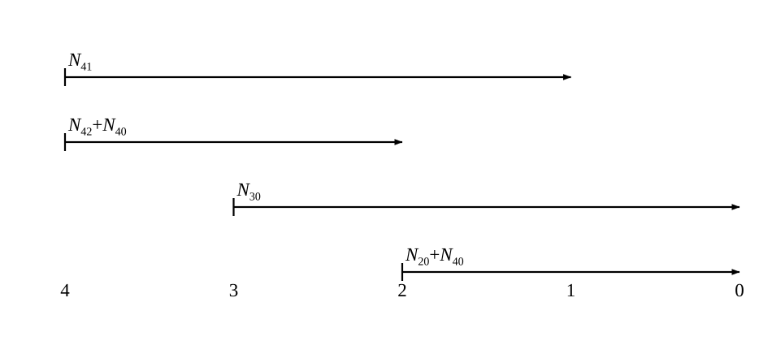
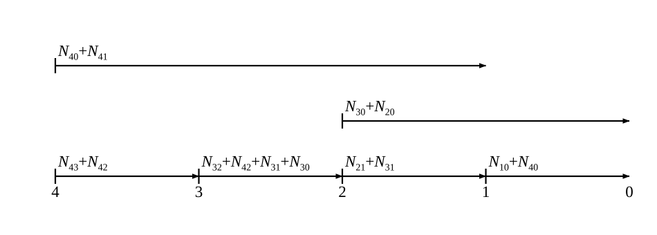

# 第十一章 技术站列车编组计划的编制

## 【本章导读】

装车地直达列车和空车直达列车编组计划编制完毕后，未被这两种列车吸收的车流，都要向就近技术站集中，到达技术站解体的装车地直达和空车直达列车中的远程车流，也要在技术站集结重新编组。技术站发出的车流，除了上面两类车流之外，还包括本站装卸完毕的重、空车流。经过车流归并，每一技术站发往前方技术站的车流都能确定下来。技术站列车编组计划的任务是对技术站发出的各支车流，按照去向分别编组成不同到站、不同种类的列车，即把技术站发出的各支车流纳入技术站编发的各支列流中去。我国铁路运行的列车，大部分是由技术站集结编组发出的，且以单组列车居多，一般在单组列车编组计划编制之后，再考虑分组列车和区段管内列车编组计划的制订。

## 【学习目标】

(1)掌握编制列车编组计划的主要因素；

(2)熟悉并掌握编制单组列车编组计划的基本原理；

(3)重点掌握利用表格计算法编制单组列车编组计划；

(4)了解分组列车及相邻编组站间列车编组计划的编制。

## 【重点及难点】

(1)编制技术站间单组直达列车编组计划的主要因素及确定；

(2)技术站车流组织的两个基本原则；

(3)利用表格计算法编制技术站间单组列车编组计划。

## 第一节 编制列车编组计划的主要因素

货物列车编组计划的编制涉及面很广, 其中主要因素有: 列车编组计划实行期间的计划车流; 车流径路方案; 各铁路方向重车列车、重空混编与空车列车的编成辆数; 各技术站大、小运转列车的车辆集结参数; 车辆无改编通过各技术站的节省时间标准; 各技术站的配置及改编作业能力; 主要装卸站的装卸能力。在编制货物列车编组计划前, 有必要对这些要素进行认真的查定或计算，以确保货物列车编组计划的编制质量。

在传统的列车编组计划编制过程中, 当车流径路确定之后, 为了选择方向上经济有利的编组方案，需要计算比较各方案的车小时总消耗。编组计划问题本质上属于组合优化问题，即在众多的编组方案中选择最佳的方案。为此, 需要确定三个比较重要的技术标准: 一是技术站间计划车流, 二是各技术站按方向别的平均一支列流一昼夜的货车集结车小时消耗, 三是各技术站平均一辆货车无改编通过所得到的车小时节省。

### 一、技术站间计划车流的确定

#### (一) 计划车流制订过程

计划车流是编制列车编组计划最重要的依据, 应当尽量使之符合客观实际。为提高编组计划的稳定性, 首先要正确选定能够反映整个编组计划实行期间车流特点的计划运量。那么怎样使这个计划运量符合未来的实际, 是一个值得深入探讨的问题。为此, 国铁集团根据所了解的主要大宗物资的流向和流量的规律性，结合国家对市场经济进行宏观调控的政策，运输市场预测及铁路运输占有份额分析, 参考各铁路局品类别装车实绩和运输能力紧张区段增加运输能力的可能性, 拟订出运输计划轮廓并下达给各铁路局; 在此基础上, 各铁路局深入厂矿企业进行货源调查, 详细了解未来年份的生产计划和分配、销售计划, 反复核实, 上下结合, 综合平衡, 参考以往规律, 最后定出切实可信的计划车流。为了使计划车流具有一定的稳定性, 一般选用第三季度或第二季度的平均运量作为制定依据。

计划车流的制订过程如图 11.1 所示。

图 11.1 计划车流制定过程示意图

#### (二)技术站间车流表

编制装车地直达列车编组计划所需的直达车流, 从品类别、发到站别的计划车流资料中查定, 编制技术站间列车编组计划所需的车流, 由技术站间车流表提供。跨局的技术站间车流表由相关铁路局共同编制, 表中所列站名由铁道部统一规定。

技术站间车流表是根据重车车流表编制出来的, 由重车车流表到技术站间车流表的过程实质上是车流归并的过程。车流归并按上、下行方向分别进行，其方法如下:

(1)技术站发出的车流包括:本站产生的车流；本站后方区段各站及衔接支线产生的车流； 到达本站解体的装车地直达列车中，若有到达前方技术站及其以远的车流，应将其归并到本站发出的车流中。

(2)技术站到达的车流包括:本站到达的车流；与本站衔接的支线上各站到达的车流；本站与前方相邻技术站间所有各站 (含衔接支线) 到达的车流。

通过车流归并, 使数量庞大且流向分散的车流转化为数量相对较少且流向较为集中的车流, 有利于车流组织的顺利进行。在技术站间车流表编制完成后, 即可分方向画出车流梯形图, 但需注意两点:

(1)把已被装车地直达列车吸收(包括补轴)的车流从总车流中剔除；

(2)把到达技术站解体的装车地直达列车中的远程车流加到相应的技术站间车流之中，其中远程车流是指到达与列车解体站邻接的前方技术站及其以远的车流。

【例 11.1】某线路方向主要技术站 ${A}_{4},{A}_{3},{A}_{2},{A}_{1},{A}_{0}$ 的分布如图 11.2 所示。经过车流归并, 由重车车流表编制出 ${A}_{4} - {A}_{0}$ 技术站间车流表 (下行),见表 11.1。从表中可以看出 ${N}_{43} = {56}$ , ${N}_{21} = {25},{N}_{20} = {83}\left( {65}\right)$ ,括号中数字为被装车地直达列车吸收的车流。

图 11.2 ${A}_{4} - {A}_{0}$ 线路主要技术站分布图

表 11.1 ${A}_{4} - {A}_{0}$ 下行方向技术站间车流表

<table><tr><td>到</td><td>$${A}_{4}$$</td><td>$${A}_{3}$$</td><td>$${A}_{2}$$</td><td>$${A}_{1}$$</td><td>$${A}_{0}$$</td></tr><tr><td>发</td><td></td><td></td><td></td><td></td><td></td></tr><tr><td>$${A}_{4}$$</td><td></td><td>56</td><td>25</td><td>70</td><td>94</td></tr><tr><td>$${A}_{3}$$</td><td></td><td></td><td>72</td><td>184(140)</td><td>65(31)</td></tr><tr><td>$${A}_{2}$$</td><td></td><td></td><td></td><td>25</td><td>83(65)</td></tr><tr><td>$${A}_{1}$$</td><td></td><td></td><td></td><td></td><td>118</td></tr><tr><td>$${A}_{0}$$</td><td></td><td></td><td></td><td></td><td></td></tr></table>

由表 11.1 可以画出 ${A}_{4} - {A}_{0}$ 下行车流梯形图 (见图 11.3 )。这时需要减去表 11.1 中括号内的数字, 此外, 还要考虑到达技术站解体的装车地直达列车中的远程车流情况。如根据该线路方向装车地直达列车编组计划, ${b}_{3} \rightarrow  {A}_{3} \rightarrow  {A}_{1}$ 的始发直达列车中包含有到 ${A}_{0}$ 和 ${A}_{0} \rightarrow  {b}_{0}$ 的车流共 31 辆,这 31 辆应为 ${A}_{1} - {A}_{0}$ 的车流,故 ${N}_{10} = {118} + {31} = {149}$ (辆)。
<table>
<tr><td>56</td></tr>
<tr><td>25</td><td>72</td></tr>
<tr><td>70</td><td>44</td><td>25</td></tr>
<tr><td>94</td><td>34</td><td>18</td><td>149</td></tr>
</table>
图 11.3 ${A}_{4} - {A}_{0}$ 线路下行车流梯形图

技术站间车流表和车流梯形图是编制技术直达列车和直通列车的基础资料，未纳入技术站间车流表的车流属于局管内的短途车流也要加以整理，作为区段管内车流组织的依据。

在计划重车流制订完毕后, 应按不同的车种分别编制计划空车流。各铁路局根据品类别发到站别的车流资料和分界口接交车资料，制订车种使用计划上报给铁道部。铁道部对各局提报的空车情况分析研究，综合平衡，统一确定各分界站车种别空车接交车数，下达给各局。各局根据铁道部下达的空车调整方案, 编制空车车流表及空车流梯形图。由于空车往往没有具体的到站, 在确定空车流向时应考虑尽量组织直达, 按最短径路调配, 扩大车种代用, 避免空车对流等原则。空车车流表和空车流梯形图是编制空车直达列车编组计划的车流依据，由于它们在格式上与重车流的类似, 因此这里就不再赘述。

### 二、货车集结车小时

货车集结车小时消耗是指在货车集结过程中消耗的车小时。关于集结车小时消耗的计算与查定方法已在第一篇介绍，这里不再详述，仅强调几个要点:

(1)货车集结车小时消耗按须满轴列流(指直达、直通、区段列流)和可欠轴列流(主要是摘挂、小运转列流)两大类分别计算确定。

(2)某支列流一昼夜的货车集结车小时消耗与该支列流平均列车编成辆数成正相关关系， 而与该支列流吸收的车流量无关。

(3)列车编组计划中规定开行的某种列车的去向称为一个列车到达站，将车流编入某去向列车称为编开某列车到达站。编开一个列车到达站一昼夜消耗的货车集结车小时 ${T}_{\text{ 集 }}$ 与该方向列车平均编成辆数 $m$ 成正相关关系,计算公式为 ${T}_{\text{ 集 }} = {cm}$ 。根据我国铁路实际情况,货车集结参数的近似值,区段站可取 $8 \sim  {10}\mathrm{\;h}$ ,编组站为 ${10} \sim  {11}\mathrm{\;h}$ 。

(4)若某方向一昼夜编组 $k$ 支列流，则该方向一昼夜总的货车集结车小时消耗为:

$$
{T}_{\text{ 集总 }} = k{T}_{\text{ 集 }} = {kcm} \tag{11.1}
$$

### 三、货车无改编通过技术站的节省时间

货车无改编通过是指货车随列车到达技术站后, 只在到发线上进行到发技术作业即随原列车继续运行，该货车称为无调中转车。货车无改编通过技术站的节省时间是指货车在技术站无改编通过较之在技术站改编所节省的时间,记作 ${t}_{\text{ 节 }}$ 。

如图 11.4 所示, ${A}_{i},{A}_{k},{A}_{j}$ 是某线路方向上的 3 个技术站,车流 $\left( {i, j}\right)$ 经过途中技术站 ${A}_{k}$ 。 图中的方案①表示:车流 $\left( {i, j}\right)$ 被纳入列流 $\langle i, k\rangle$ 而在 ${A}_{k}$ 站改编,然后再纳入列流 $\langle k, j\rangle$ 到达 ${A}_{j}$ 站。方案②表示:车流 $\left( {i, j}\right)$ 被列流 $\langle i, j\rangle$ 所吸收而在 ${A}_{k}$ 站无改编通过。那么由方案①变到方案②,在 ${A}_{k}$ 站究竟能节省多少车小时?

图 11.4 两个不同的编组方案

设 ${A}_{k}$ 站的有调中转车和无调中转车的停留时间标准分别为 ${t}_{\text{ 有 }}$ 和 ${t}_{\text{ 无 }}$ ,在方案 ①中，车流 $\left( {i, j}\right)$ 在 ${A}_{k}$ 站总共停留 ${N}_{ij}{t}_{\text{ 有 }}$ 车小时，在方案②中，为 ${N}_{ij}{t}_{\text{ 无 }}$ 车小时，二者之差 ${N}_{ij}\left( {{t}_{\text{ 有 }} - {t}_{\text{ 无 }}}\right)$ 即为车流 $\left( {i, j}\right)$ 本身节省的车小时。

但 $\left( {i, j}\right)$ 在 ${A}_{k}$ 站由有改编作业变为无改编通过,将导致列流 $\langle k, j\rangle$ 所吸收的总车流量发生变化,即由 ${N}_{kj} + {N}_{ij}$ 减少为 ${N}_{kj}$ 。这样, ${A}_{k}$ 站每车集结时间由 ${t}_{\text{ 集 }} = \frac{{T}_{\text{ 集 }}}{{N}_{kj} + {N}_{ij}}$ 变为 ${t}_{\text{ 集 }}^{\prime } = \frac{{T}_{\text{ 集 }}}{{N}_{kj}}$ 。由于同一支列流的 ${T}_{\text{ 集 }}$ 与该支列流吸收的车流量无关,故 ${t}_{\text{ 集 }} < {t}_{\text{ 集 }}^{\prime }$ 。这表明,每车集结时间延长了,由此使得车流 $\left( {k, j}\right)$ 在 ${A}_{k}$ 站的集结车小时增加,其增加值为:

$$
{N}_{kj}\left( {\frac{{T}_{\text{ 集 }}}{{N}_{kj}} - \frac{{T}_{\text{ 集 }}}{{N}_{kj} + {N}_{ij}}}\right)  = {N}_{ij}{t}_{\text{ 集 }}
$$

这是由于方案变化而导致的损失,不能忽略。因此,由方案①到方案②,在 ${A}_{k}$ 站获得的节省为 ${N}_{ij}\left( {{t}_{\text{ 有 }} - {t}_{\text{ 无 }} - {t}_{\text{ 集 }}}\right)$ 车小时。于是,车流 $\left( {i, j}\right)$ 中的每辆货车无改编通过技术站的平均节省时间为 $\left( {{t}_{\text{ 有 }} - {t}_{\text{ 无 }} - {t}_{\text{ 集 }}}\right)$ 小时。

由于上面的分析只考虑了车辆停留时间方面的节省。实际上, 车辆无改编通过技术站还会使该站的改编作业车数减少，从而调车工作量减少，这方面的节省也是应当考虑的。

为使改编车数与车小时具有可比性, 引入改编作业当量这个概念, 它是指调机平均改编 1 辆货车 (1 解 1 编计为 1 辆) 所折合的车小时数,记作 ${r}_{\text{ 车 }}$ 。设调机工作 1 小时的成本为 ${e}_{\text{ 机时 }}$ , 每 1 货车停留车小时的成本为 ${e}_{\text{ 车时 }}$ ,调机工作 1 小时所能改编的车数为 ${N}_{\text{ 调 }}$ ,则由 ${r}_{\text{ 车 }}$ 的定义:

$$
{r}_{\text{ 车 }} = \frac{{e}_{\text{ 机时 }}}{{N}_{\text{ 调 }}{e}_{\text{ 车时 }}} \tag{11.2}
$$

因此，平均每车无改编通过技术站的换算节省时间 ${t}_{\text{ 节 }}$ 为:

$$
{t}_{\text{ 节 }} = {t}_{\text{ 有 }} - {t}_{\text{ 无 }} - {t}_{\text{ 集 }} + {r}_{\text{ 车 }} \tag{11.3}
$$

货车无改编通过技术站节省时间 ${t}_{\text{ 节 }}$ 应根据每个技术站分别确定，其中 ${t}_{\text{ 有 }}$ 和 ${t}_{\text{ 无 }}$ 的数值可以根据车站技术作业过程和列车运行图来查定, ${t}_{\text{ 集 }}$ 的数值可用统计分析法查定。

关于 ${t}_{\text{ 节 }}$ 的取值,影响因素很多,主要取决于车站的调车技术设备、作业方法、组织水平、 一昼夜总车流量及有调中转车所占比重。应该指出, 各影响因素相当复杂且常常会变化, 因此利用上式计算的 ${t}_{\text{ 节 }}$ 只是一个近似值。根据有关资料,自动化和机械化驼峰编组站 ${t}_{\text{ 节 }}$ 可近似取 $2 \sim 3\mathrm{\;h}$ ,非机械化驼峰编组站可取 $3 \sim  4\mathrm{\;h}$ ,区段站可取 $4 \sim  7\mathrm{\;h}$ 。

# 第二节 编制单组列车编组计划的基本原理

### 一、技术站车流组织的两个原则

#### (一)同一支车流不拆散原则

技术站发出的车流有许多支, 一般不可能每一支车流都单独形成一支列流, 故有两支及其以上的车流合并在一起, 共同合成一支较短程的列流开往较近的技术站。当车流合并时, 不应当将同一支车流的车流量分离出来, 分别与不同的车流合并, 纳入几支不同的列流中。这是车流组织的一个原则, 即同一支车流不拆散原则。

例如, 在图 11.5 中, 有 4 个技术站的线路方向共有 6 支车流, 其中 3 支长途车流, 3 支短途车流。按照同一支车流不拆散原则,不能从 ${N}_{30}$ 中分离出一部分与 ${N}_{31}$ 合并,纳入列流 $\langle 3,1\rangle$ , 而把另一部分与 ${N}_{32}$ 合并,纳入列流 $\langle 3,2\rangle$ 。

图 11.5 4 个技术站方向的车流图

#### (二)车流接续归并原则

在车流合并之后, 流程较长的车流不得不 “迁就” 流程较短的车流, 在某一技术站改编, 然后继续前进。这时, 长程车流便成为该技术站发出的车流的一部分, 与该站相同到站的车流合并开行。这是车流组织的又一原则，即车流接续归并原则。

如图 11.5 中,若 ${N}_{30}$ 与 ${N}_{31}$ 合并,在 ${A}_{1}$ 站改编,那它便加入 ${A}_{1}$ 站的车流队伍中,并始终与 ${N}_{31}$ 合在一起开行。

### 二、编组方案表示法

任何一支远程车流，如果开行直达列车到达站，须将该到达站的车流划分出来单独集结， 从而要产生一个到达站列车的货车集结车小时 $\left( {cm}\right)$ 损失，但开行直达列车在沿途各技术站无须进行改编作业，从而获得无改编通过的车小时节省 $\left( {{N}_{\text{ 直 }}\sum {t}_{\text{ 节 }}}\right)$ ，当节省不小于损失时，就可以认为该支车流具备了单独开行直达列车的基本条件，一般可用下式表示:

$$
{N}_{\text{ 直 }}\sum {t}_{\text{ 节 }} \geq  {cm} \tag{11.4}
$$

式中 ${N}_{\text{ 直 }}$ ——该到达站一昼夜的车流量；

$\sum {t}_{\text{ 节 }}$ ——车流无改编通过沿途技术站总节省时间；

${cm}$ ——该车流开行直达列车一昼夜消耗的集结车小时。

但是, 按上式确定整个方向上应开行的直达列车到达站, 即确定列车编组计划方案并不总是有利的, 若将某些具有共同径路的直达列车合起来开行, 并撤销一些直达列车到达站, 可能会获得更多的车小时节省。由此可知, 一支列流是由车流组合而成的 (车流可以单开, 也可以合开)，把车流变成列车流的编组方案，实质上就是车流的组合方案。同一技术站发出的车流相互组合形成该技术站的编组方案，方向上各技术站的编组方案配合起来构成方向上的编组方案。 如图 11.6 所示, 在 4 个技术站的方向上, 图中给出了两个编组方案的列车到达站图。

图 11.6 有四个技术站方向的各站编组方案图

技术站的编组方案用阿拉伯数字、加号“ + ”和逗号“,”所组成的式子表示。阿拉伯数字代表车流的到达站，“+”表示车流合并开行，“，”表示车流不合并。

例如,在图 11.6 中,对于 ${A}_{3}$ 站的 ${N}_{30},{N}_{31},{N}_{32}$ 都单开,则编组方案为 “ 0,1,2 ”; 如果 ${N}_{30}$ 与 ${N}_{31}$ 合并形成列流 $\langle 3,1\rangle ,{N}_{32}$ 单开,则编组方案为 “ $0 + 1,2$ ”。

把方向上各技术站的编组方案写在一起, 中间用分号 “;”隔开, 便可以表示方向上的编组方案。如图 11.6 所示,方案 I 表示为 “ $2 + 1,0;1 + 0;0$ ”,方案 II 表示为 $2 + 0,1;1,0;0$”。当然也可以已知编组方案表达式,写出具体方案并画出列车到达站图。例如, ${A}_{3}$ 站的编组方案为 “ $2 + 1,0$ ”,则表示 ${A}_{3}$ 站将 ${N}_{30}$ 单独开行到 ${A}_{0}$ 站，将 ${N}_{31}$ 与 ${N}_{32}$ 合并开行。应当注意的是, 在画列车到达站图确定各支列流吸收的车流内容时, 必须遵循车流接续归并原则。

### 三、单组列车编组方案数

单组列车编组计划可能的方案数取决于方向上的车流支数, 从而也取决于方向上参与计算的技术站数。表 11.2 列出了有 2~9 个技术站的直线方向单组列车编组方案数。

表 11.2 直线方向单组列车编组方案数

<table><tr><td>技术站数量</td><td>2</td><td>3</td><td>4</td><td>5</td><td>6</td><td>7</td><td>8</td><td>9</td></tr><tr><td>技术站的编组方案数</td><td>1</td><td>2</td><td>5</td><td>15</td><td>52</td><td>203</td><td>877</td><td>4140</td></tr><tr><td>全部编组方案数</td><td>1</td><td>2</td><td>10</td><td>150</td><td>7800</td><td>1583400</td><td>$$\approx  {1.39} \times  {10}^{9}$$</td><td>$$\approx  {5.75} \times  {10}^{12}$$</td></tr><tr><td>相邻车流合并后技术站的编组方案数</td><td>1</td><td>2</td><td>4</td><td>8</td><td>16</td><td>32</td><td>64</td><td>128</td></tr><tr><td>相邻车流合并的编组方案数</td><td>1</td><td>2</td><td>8</td><td>64</td><td>1024</td><td>32768</td><td>2097152</td><td>268435456</td></tr></table>

从表中可以看出, 随着技术站的增大, 方案数目爆炸式地增长。如何解决这种 “组合爆炸” 问题, 是车流组织面临的一大难题。而且我国幅员辽阔, 铁路线长, 有些方向的技术站数远远超过 9 个, 为了减少计算的编组方案数, 通常采用的方法是分阶段计算法, 即根据车流集散规律把全路划分成多个地区或方向，使每个地区或方向包含少数几个主要编组站(亦称支点站)。 一般情况下，支点站的选择应注意:

(1)是大量车流产生或消失的地点；

(2)具有先进的技术设备和强大的改编能力；

(3)是变更列车重量(或换长)标准的地点；

(4)是地理上的自然分界点，如国际联运的口岸站，水陆联运的交接站，其本身又往往是铁路方向的起讫点等;

(5)是位于几条铁路线交汇处的枢纽编组站。

分阶段计算法的要点是把计算工作分为两步进行:第一步，计算方向上支点站的单组列车编组计划; 第二步,分别计算各相邻支点站之间的单组列车编组计划。如图 11.7 所示, $A$ 一D 方向上虽有 11 个技术站, 但在采取分阶段计算时, 每次同时参与计算的技术站数不超过 5 个，从而大大减少了计算工作量。

图 11.7 $A - D$ 方向分步骤计算列车编组计划.

### 四、总体思路

在众多的编组方案中选择最优的方案, 实质上是大规模的组合优化问题。关于优化目标有两种考虑, 一个是以方向上总的车小时消耗最小为目标, 另一个是以方向上总的车小时节省最大为目标。为简化起见, 在计算方案值时, 与方案变化无关的车小时消耗 (或节省) 均不列入计算。

关于优化算法, 国内外专家学者进行了长期的研究和探索, 提出了各种各样的优化方法。 按其性质可以归纳为三大类:

第一类是穷举法, 也可称为绝对计算法, 就是对所有的编组方案逐一计算其车小时总消耗, 其中总消耗最小的方案即为最优方案。

第二类是筛选法, 其要点是通过一定的判别条件来删除或排除部分不利的方案, 精简方案数, 缩小搜索范围, 而对未删除的方案进行分析比较, 逐步选出经济有利的方案。属于这一类方法的有分析计算法、表格计算法、树形筛选法、寻求直达列车有利去向数法等，其中以表格计算法使用最为普遍, 将在后面做详细介绍。

第三类是数学规划法, 就是把车流组织问题化为一类数学规划问题来建模求解。属于这一类的有整数规划法、动态规划法、二次 0-1 规划法、网络分析法等。

## 第三节 单组列车编组计划的编制

### 一、绝对计算法

绝对计算法是最原始的方法, 其算法思想简单, 但计算工作量较大。

#### (一) 目标函数

在确定支点站单组列车编组计划时, 从一个支点站至相邻支点站的列车是必开的, 也就是说无论什么编组方案，相邻支点站间的直达列流(也称短途列流)总是存在的，它的车小时消耗是与方案变化无关的。因此, 在计算时, 只对非相邻支点站间的直达列流 (也称非短途列流) 计算集结车小时消耗和途中改编车小时消耗。

以 ${F}_{\text{ 耗 }}$ 表示方向上总的车小时消耗,绝对计算法的目标函数为:

$$
\min {F}_{\text{ 耗 }} = {F}_{\text{ 集 }} + {F}_{\text{ 改 }} \tag{11.5}
$$

式中 ${F}_{\text{ 集 }}$ 一所有非短途列流在始发站产生的集结车小时总消耗;

${F}_{\text{ 改 }}$ ——所有直达车流在途中支点站的改编车小时总消耗。

把编开非短途列流的支点站集合记作 $\mathbf{Z}$ ,设 $i \in  \mathbf{Z}, i$ 站编发的直达列流有 ${k}_{i}$ 支, $i$ 站的 ${T}_{\text{ 集 }}$ 记作 ${T}_{\text{ 集 }}^{i}$ ,则

$$
{F}_{\text{ 集 }} = \mathop{\sum }\limits_{{i \in  \mathbf{Z}}}{k}_{i}{T}_{\text{ 集 }}^{i} \tag{11.6}
$$

把有车流改编的支点站集合记作 $\mathbf{G}$ ,设 $j \in  \mathbf{G}$ ,在 $j$ 站改编的车流量为 ${N}_{\text{ 改 }}^{j}, j$ 站的 ${t}_{\text{ 节 }}$ 记作 ${t}_{\text{ 节 }}^{j}$ , 则

$$
{F}_{\text{ 改 }} = \mathop{\sum }\limits_{{j \in  \mathbf{G}}}{N}_{\text{ 改 }}^{j}{t}_{\text{ 节 }}^{j} \tag{11.7}
$$

因此, 式 (11.5) 可写成:

$$
\min {F}_{\text{ 耗 }} = \mathop{\sum }\limits_{{i \in  \mathbf{Z}}}{k}_{i}{T}_{\text{ 集 }}^{i} + \mathop{\sum }\limits_{{j \in  \mathbf{G}}}{N}_{\text{ 改 }}^{j}{t}_{\text{ 节 }}^{j} \tag{11.8}
$$

#### (二)计算方法

为了计算方便, 绝对计算法首先设计了一种计算表格。对每一个编组方案填制一张计算表格, 表格分上、下两部分。

上半部分:行对应非短途直达车流，方向上有几支直达车流就设几行；列对应沿途支点站。 编组方案表达式写于右侧。若某支非短途直达车流在某站改编，则在相应的格子内填记该支车流的车流量; 否则填 “ 0 ”，表示无改编通过。

下半部分: 第 1 行是各支点站的改编车数 ${N}_{\text{ 改 }}^{j}\left( {j \in  \mathbf{G}}\right)$ ,最右端的格子内填记 $\mathop{\sum }\limits_{{j \in  G}}{N}_{\text{ 改 }}^{j}$ 。第 2 行是各支点站的改编车小时消耗 ${N}_{\text{ 改 }}^{j}{t}_{\text{ 节 }}^{j}$ ，最右端的格子内填写 $\mathop{\sum }\limits_{{j \in  \mathbf{G}}}{N}_{\text{ 收 }}^{j}{t}_{\text{ 节 }}^{j}$ 。第 3 行填 ${A}_{n - 1}$ 站 ( $n$ 是方向上支点站数) 编发的直达列流支数 ${k}_{n - 1}$ ,最右端的格子内填记 ${k}_{n - 1}{T}_{\text{ 集 }}^{n - 1}$ 。以下各行类推,直至 ${A}_{2}$ 站。最右下端的表格内填记该编组方案的方案值 ${F}_{\text{ 耗 }}$ 。

图 11.8 画出了 4 个支点站方向的计算表格形式, 对应的是图 11.6 中的编组方案 I 。 <table><tr><td>$A_3$</td><td>$A_2$</td><td>$A_1$</td><td>$A_0$</td></tr>
<tr><td>$T_集^3$</td><td>$T_集^2$</td></tr>
<tr><td>—</td><td>$t_节^2$</td><td>$t_节^1$</td></tr>
<tr><td>$N_{31}$</td><td>$N_{31}$</td></tr>
<tr><td>$N_{30}$</td><td>0</td><td>0</td></tr>
<tr><td>$N_{20}$</td><td>—</td><td>$N_{20}$</td></tr>
<tr><td>$N_{改编}$</td><td>$N_{31}$</td><td>$N_{20}$</td></tr>
<tr><td>$N_{改编}t_节$</td><td>$N_{31}t_节^2$</td><td>$N_{20}t_节^1$</td><td>$N_{31}t_节^2+N_{20}t_节^1$</td></tr>
<tr><td>$T_集^3$</td><td colspan='2'>$K_3=1$</td><td>$K_3T_集^3$</td></tr>
<tr><td colspan='3'>$F_耗$</td><td>$N_{31}t_节^2+N_{20}t_节^1+K_3T_集^3$</td></tr>
</table>

图 11.8 4 个支点站的绝对计算法计算表格形式

图 11.8 的方案特征为 $2 + 1,0;1 + 0$ 。由于 ${A}_{3}$ 站将 ${N}_{20}$ 单独开行直达列车到达站,所以 ${N}_{30}$ 在 ${A}_{2}$ 和 ${A}_{1}$ 站都无改编通过,因而在 ${N}_{30}$ 行与 ${A}_{2}\text{ 、 }{A}_{1}$ 两列的交叉方格内填 “ 0 ”; ${A}_{3}$ 站将 ${N}_{31}$ 和 ${N}_{32}$ 合并开行列车到达站, ${N}_{31}$ 要在 ${A}_{2}$ 站改编,所以在 ${N}_{31}$ 行与 ${A}_{2}$ 列的交叉方格内填写 ${N}_{31}$ 的车数; ${A}_{2}$ 站将 ${N}_{21}$ 和 ${N}_{20}$ 和开到达站,即 ${N}_{20}$ 将在 ${A}_{1}$ 站改编,在 ${N}_{20}$ 行与 ${A}_{1}$ 列交叉方格内填写 ${N}_{20}$ 的车数。

图 11.8 下半部分 ${A}_{2}$ 站的改编车总数为 ${N}_{31},{A}_{1}$ 站的改编车总数为 ${N}_{20}$ ,各站改编车总数为 ${N}_{31} + {N}_{20} \circ  {A}_{2}$ 站消耗的改编车小时为 ${N}_{31}{t}_{\text{ 节 }}^{2},{A}_{1}$ 站的消耗的改编车小时为 ${N}_{20}{t}_{\text{ 节 }}^{1}$ ,总计为 ${N}_{31}{t}_{\text{ 节 }}^{2} + {N}_{20}{t}_{\text{ 节 }}^{1}{\Delta }_{3}$ 站的方案特征为 $2 + 1,0$ ,开行一个直达列车到达站,产生一个 $c{m}_{3}$ 的集结车小时; ${A}_{2}$ 站的方案特征为 $1 + 0$ ,不开行直达列车到达站,即不消耗集结车小时。该编组方案的全部车小时消耗为: ${N}_{31}{t}_{\text{ 节 }}^{2} + {N}_{20}{t}_{\text{ 节 }}^{1} + c{m}_{3}$ 。

对每一编组方案填写计算表, 求出该方案的改编车数和车小时总消耗, 便可从中选出经济合理的编组方案。填写计算表时, 重点是编组方案的特征, 根据这一特征, 填写各支直达车流在沿途技术站的改编车数和各站开行的直达列车到达站数。

通过分析编组方案的构成可以发现, 有些方案与其他方案相比是显然不利的, 因而不用具体计算出方案值即可将其排除在外。产生显然不利方案的情况有两种:

(1)当远程车流与短程车流合并时，额外增加改编作业次数；

(2)当远程车流与短程车流合并时，虽改编次数不变，但在 ${t}_{\text{ 节 }}$ 值较大的支点站改编。

【例 11.2】已知 4 个支点站的线路方向共有 10 个编组方案, 它们的方案特征及对应的直达列车到达站图如图 11.9 所示。

<table><tr><td>编组方案</td><td></td></tr><tr><td>① 0,1,2; 0,1 ; 0</td><td></td></tr><tr><td>② 0,1+2 ; 0,1 ; 0</td><td></td></tr><tr><td>③ 0+1,2; 0,1 ; 0</td><td></td></tr><tr><td>④ 0+2,1; 0,1; 0</td><td></td></tr><tr><td>⑤ 0+1+2; 0,1 ; 0</td><td></td></tr><tr><td>⑥ 0,1,2; 0+1 ; 0</td><td></td></tr><tr><td>⑦ 0,1+2; 0+1 ; 0</td><td></td></tr><tr><td>⑧ 0+1,2; 0+1; 0</td><td></td></tr><tr><td>⑨ 0+2,1; 0+1 ; 0</td><td></td></tr><tr><td>⑩ 0 + 1 + 2; 0+1 ; 0</td><td></td></tr></table>

图 11.9 4 个支点站的方向上单组列车编组方案及直达列车到达站图

分析图 11.9 中的 10 个方案不难发现,方案⑨是显然不利方案,因为与方案⑧相比, ${N}_{30}$ 在 ${A}_{2}$ 站增加一次改编作业。另外,方案③与方案④比较,如果 ${t}_{\text{ 节 }}^{2} > {t}_{\text{ 节 }}^{1}$ ,则方案④是显然不利方案, 因为 ${N}_{30}{t}_{\text{ 节 }}^{2} > {N}_{30}{t}_{\text{ 节 }}^{1}$ ,反之,方案③是显然不利方案。

对全部编组方案都计算出方案值 ${F}_{\text{ 耗 }}$ 之后,从中选出 ${F}_{\text{ 耗 }}$ 最小的方案作为经济上最优的方案。但我们的目的是求既经济有利又实际可行的最佳方案, 因此还需把最优方案中各站的改编车数与该站的改编能力比较。如果都能满足, 则最优方案也就是最佳方案, 否则, 只要有一个支点站的改编能力小于改编车数，都要进行调整，即找出次优方案来比较，若不行还需调整， 直至所有支点站的改编能力都不小于改编车数为止。

【例 11.3】用绝对计算法确定 ${A}_{3} - {A}_{0}$ 方向单组列车编组计划最优方案,并绘制列车到达站图, 资料如图 11.10 所示 (各站改编能力不受限制)。
<table>
<tr><td></td><td>$A_3$</td><td>$A_2$</td><td>$A_1$</td><td>$A_0$</td></tr>
<tr><td>$T_集$</td><td>500</td><td>600</td></tr>
<tr><td>$t_节$</td><td></td><td>4</td><td>3</td></tr>
</table>
<table>
<tr><td>—</td></tr>
<tr><td>120</td><td>—</td></tr>
<tr><td>100</td><td>80</td><td>—</td></tr>
</table>
图 11.10 例 11.3 计算资料

解: 4 个支点站的线路方向共有 10 个编组方案, 其方案特征及对应的直达列车到达站图如图 11.11 所示。采用绝对计算法, 计算得出各方案的方案值, 如图 11.11 所示。

<table><tr><td>编组方案</td><td></td><td>耗费车小时</td></tr><tr><td>① 0,1,2; 0,1; 0</td><td></td><td>1600</td></tr><tr><td>② 0,1+2; 0,1; 0</td><td></td><td>1580</td></tr><tr><td>③ 0+1,2; 0,1 ; 0</td><td></td><td>1400</td></tr><tr><td>④ 0+2,1; 0,1 ; 0</td><td></td><td>1500</td></tr><tr><td>⑤ 0+1+2; 0,1 ; 0</td><td></td><td>1480</td></tr><tr><td>⑥ 0,1,2 ; 0+1 ; 0</td><td></td><td>1240</td></tr><tr><td>⑦ 0,1+2 ; 0+1 ; 0</td><td></td><td>1220</td></tr><tr><td>⑧ 0+1,2; 0+1; 0</td><td></td><td>1040</td></tr><tr><td>⑨ 0+2,1; 0+1 ; 0</td><td></td><td>1440</td></tr><tr><td>⑩ 0 + 1 + 2; 0 + 1; 0</td><td></td><td>1 420</td></tr></table>

图 11.11 4 个支点站的方向上单组列车编组方案计算表

根据这 10 种方案的车小时消耗情况, 选择方案 8 为最佳方案。

### 二、表格计算法

#### (一)算法原理

在车流组织中, 绝对计算法是寻求车小时总消耗最小的方案, 而表格计算法是寻求车小时总节省最大的方案，虽然两者所追求的目标不同，但所得的最后结果是一样的。

假定存在一个方向上每支车流在途中每个支点站都改编的编组方案 (即一支直达列流也没有的方案)。这样，任何一个编组方案与它比较，只要有某支车流(设车流量为 ${N}_{\text{ 通 }}$ )在某支点站无改编通过,相对于这个假想的方案就有车小时节省 ${N}_{\text{ 通 }}{t}_{\text{ 节 }}$ 。把方案中有无改编通过车流的支点站集合记作 $W$ ，设 $w \in  W$ ，在 $w$ 站无改编通过的车流量为 ${N}_{\text{ 通 }}^{w}$ ， $w$ 站的 ${t}_{\text{ 节 }}$ 为 ${t}_{\text{ 节 }}^{w}$ ，则直达车流无改编通过途中支点站的车小时总节省 ${F}_{\text{ 通 }}$ 为:

$$
{F}_{\text{ 通 }} = \mathop{\sum }\limits_{{w \in  W}}{N}_{\text{ 通 }}^{w}{t}_{\text{ 节 }}^{w} \tag{11.9}
$$

以 ${F}_{\text{ 节 }}$ 表示编组方案总的车小时节省,则

$$
{F}_{\text{ 节 }} = {F}_{\text{ 通 }} - {F}_{\text{ 集 }}
$$

上式中的 ${F}_{\text{ 集 }}$ 按式 (11.6) 计算。于是,用表格计算法选取最优方案的目标函数为:

$$
\max {F}_{\text{ 节 }} = \mathop{\sum }\limits_{{w \in  W}}{N}_{\text{ 通 }}^{w}{t}_{\text{ 节 }}^{w} - \mathop{\sum }\limits_{{i \in  Z}}{k}_{i}{T}_{\text{ 集 }}^{i} \tag{11.10}
$$

就算法思想而言, 表格计算法并不对全部编组方案计算方案值, 而是利用几个判别条件, 把肯定有利的列流 (如果存在的话) 首先确定下来, 把不合理的列流排除在外, 对可能有利的列流按不同的车流合并方式计算车小时节省，然后加以比较再选择最优方案。这些判别条件包括绝对条件、必要条件和充分条件。

##### 1. 绝对条件

任何一支远程车流必须开行直达列流的绝对条件是:该支车流在沿途任一支点站无改编通过的车小时节省都不小于该车流编开直达列流在列车始发站的集结车小时消耗。

以 $K$ 记直达车流 $\left( {i, j}\right)$ 的途中支点站集合,则绝对条件可表示成下式:

$$
{N}_{ij} \cdot  \min \left\{  {{t}_{\text{ 节 }}^{k} \mid  k \in  \mathbf{K}}\right\}   \geq  {T}_{\text{ 集 }}^{i} \tag{11.11}
$$

【例 11.4】图 11.12 表示出 4 个支点站方向的 3 支直达车流量、各支点站的 ${T}_{\text{ 集 }}$ 和 ${t}_{\text{ 节 }}$ 。

$N_{30}=115$  
$N_{31}=95$  
$N_{20}=185$  
$T_集^3=500$  
$T_集^2=540$  
$t_节^2=4.0$  
$t_节^1=3.0$  

图 11.12 例 11.4 计算资料

因为, ${N}_{20} \cdot  {t}_{\text{ 节 }}^{1} = {185} \times  {3.0} = {555} > {T}_{\text{ 集 }}^{2} = {540}$ ,所以,车流 $\left( {2,0}\right)$ 满足了绝对条件,应当开行直达列流 $\langle 2,0\rangle$ ,并归入最优编组方案中。

绝对条件的道理是很明显的。若不开行直达列流 $\langle 2,0\rangle$ ,则 ${N}_{20}$ 与 ${N}_{21}$ 合并开行,固然因少一支列流而获得 ${T}_{\text{ 集 }}^{2} = {540}$ 车小时的节省，但 ${N}_{20}$ 将在 ${A}_{1}$ 站改编，原来可以节省的 ${N}_{20} \cdot  {t}_{\text{ 节 }}^{1} = {555}$ 车小时就会损失掉,得不偿失,所以应当开行直达列流 $\langle 2,0\rangle$ 。

由绝对条件可以得到一个推论: 若

$$
{N}_{ij}{t}_{\text{ 节 }}^{k} \geq  {T}_{\text{ 集 }}^{i} \tag{11.12}
$$

则车流 $\left( {i, j}\right)$ 不应在 $k$ 站改编。此时,称车流 $\left( {i, j}\right)$ 在支点站 $k$ 满足了绝对条件。

##### 2. 必要条件

任何一支远程车流单开的必要条件是:该支车流无改编通过沿途支点站所获得的车小时总节省不小于该车流编开直达列流在列车始发站的集结车小时消耗，即

$$
{N}_{ij}\mathop{\sum }\limits_{{k \in  K}}{t}_{\text{ 节 }}^{k} \geq  {T}_{\text{ 集 }}^{i} \tag{11.13}
$$

若干支远程车流 (设其中最短的车流为 $\left( {i, j}\right)$ ,总车流量为 $\sum N$ ) 合开的必要条件是: 这些车流合并之后无改编通过沿途支点站所获得的车小时总节省不小于它们合开直达列流在列车始发站的集结车小时消耗，即

$$
\sum N\mathop{\sum }\limits_{{k \in  K}}{t}_{\text{ 节 }}^{k} \geq  {T}_{\text{ 集 }}^{i} \tag{11.14}
$$

必要条件的道理也是显然的。如果某车流编开直达列流得到的无改编车小时节省小于其集结车小时消耗，得到的净节省将是负值，说明开行直达列流肯定不利，所以不满足必要条件的车流不应当开行直达列流, 只有满足必要条件者才可以考虑开行。

如图 11.12 所示, 因为

$$
{N}_{30}\left( {{t}_{\text{ 节 }}^{2} + {t}_{\text{ 节 }}^{1}}\right)  = {115} \times  \left( {4 + 3}\right)  = {805} > {T}_{\text{ 集 }}^{3} = {500}
$$

所以， ${N}_{30}$ 单开满足必要条件。

若 ${N}_{30}$ 与 ${N}_{31}$ 合并开行直达列流 $\langle 3,1\rangle$ ,也满足必要条件,因为

$$
\left( {{N}_{30} + {N}_{31}}\right) {t}_{\text{ 节 }}^{1} = \left( {{115} + {95}}\right)  \times  3 = {630} > {T}_{\text{ 集 }}^{3} = {500}
$$

##### 3. 充分条件

一支(或几支合并的)长程车流不与某支短程车流合并的充分条件是:长程车流在其超行区段无改编通过支点站的车小时总节省不小于该车流编开直达列流在始发站的集结车小时消耗。这里的“超行区段”，是指长程车流比短程车流多运行的那部分区段。

在图 11.12 中,检查 ${N}_{30}$ 对 ${N}_{31}$ 是否满足充分条件,因为

$$
{N}_{30} \cdot  {t}_{\text{ 节 }}^{1} = {115} \times  3 = {345} < {T}_{\text{ 集 }}^{3} = {500}
$$

可见不满足充分条件, 即可以考虑合开。

上述必要条件和充分条件可以用来删除某些不合理的车流组合方式, 起到精简方案的作用, 但它们都不是绝对条件, 都只具有相对的意义。必要条件是车流单开 (或合开) 直达列流所必须具备的前提条件, 不满足必要条件就不应开行, 满足了必要条件则可以考虑开行, 但也未必一定开行, 还需经过比较确定, 看哪种车流合并方式节省的车小时较多。充分条件是长程车流不与短程车流合并的条件, 满足了就不应合并开行, 但不满足是否就一定要合并, 也需比较确定。只有绝对条件才是真正 “绝对” 的, 满足了它就一定要开行直达列流, 否则在经济上就是不利的。

#### (二) 算法步骤

表格计算法是利用特制的计算表格来完成的, 首先按照必要条件和绝对条件求得最大可能的直达方案作为初始方案, 然后根据充分条件依次比较, 通过各种不同的压缩直达车流运行距离的方式而得到越来越优的车流组合方案, 直到不可能取得更多的车小时节省为止, 即可得到最经济有利的方案。

计算表格分成上、下两部分。上半部分与绝对计算法表格的上半部分完全一样, 但每个格子内填记的是各支直达车流量 ${N}_{\text{ 通 }}$ 与途中支点站 ${t}_{\text{ 节 }}$ 的乘积 ${N}_{\text{ 通 }}{t}_{\text{ 节 }}$ 。下半部分只有两行,第 1 行填记最优方案各支点站的改编车数，第 2 行填记各支点站的改编能力，目的是检查经济上有利的方案是否切实可行。

表格计算法的计算步骤及方法如下:
<table>
<tr><td>$A_3$</td><td>$A_2$</td><td>$A_1$</td><td>$A_0$</td></tr>
<tr><td></td><td>$t_节^2$</td><td>$t_节^1$</td><td></td></tr>
<tr><td>$N_{31}$</td><td>$N_{31}t_节^2$</td></tr>
<tr><td>$N_{30}$</td><td>$N_{30}t_节^2$</td><td>$N_{30}t_节^1$</td></tr>
<tr><td>$N_{20}$</td><td>—</td><td>$N_{20}t_节^1$</td></tr>
<tr><td>$\sum N_{改编}$</td><td></td><td></td><td></td></tr>
<tr><td>改编能力</td><td></td><td></td><td></td></tr>
</table>

图 11.13 表格计算法的计算表格

第 1 步,根据给定数据计算所有的 ${N}_{\text{ 通 }}{t}_{\text{ 节 }}$ 值,并填入计算表的相应格内。

第 2 步, 确定初始方案:

(1)对满足绝对条件式 (11.11) 的单支车流 $\left( {i, j}\right)$ ，在其各格内画上 “ $\bigtriangleup$ ” 记号，表示列流 $\langle i, j\rangle$ 确定开行; 若某支车流在支点站 $k$ 满足了绝对条件式 (11.12),亦在相应格内画上 “ $\bigtriangleup$ ” 记号,表示该车流不在 $k$ 站改编。

(2)对满足必要条件式 (11.13) 的单支车流，在其各格内画上 “ $○$ ” 记号，表示暂定为单开。

(3)对其余车流，考虑相互合并，若满足必要条件式 (11.14)，在格内画 “ $○$ ” 记号；若不满足，则考虑与已画 “ $\bigtriangleup$ ” 或 “ $○$ ” 记号的车流合并，合并后也在相应格内画 “ $○$ ” 记号， 表示经合并增加了一个新的编组到达站。

至此, 初始方案确定完毕, 初始方案是直达列车到达站数最多的方案。

第 3 步，调整初始方案，逐步寻求最优方案。

调整工作可直接在计算表上进行。调整的实质是利用必要条件和充分条件, 寻找更为有利的车流组合方式。调整的方法是根据车流分合原理, 依次比较通过压缩长程车流直达运行距离或变更长程车流与某些短程车流组合方式, 逐步寻找节省车小时最多的方案。直观地看, 对长程车流可采取两种办法:

(1)压缩。压缩长程车流的到站、发站，或同时压缩发、到站，使之与短程车流合并。

(2)切割。把一支长程车流分割成两部分或更多部分，分别与两支或多支短程车流合并。 显然, 调整将会引起车小时得失的变化, 其变化表现在以下几个方面:

① 直达列流支数的变化。列流支数增加 (减少),就有 ${T}_{\text{ 集 }}$ 的损失 (节省);

② 直达列流始发站的变更。若始发站由 ${A}_{i}$ 变为 ${A}_{j}$ ，则集结车小时消耗由 ${T}_{\text{ 集 }}^{i}$ 变为 ${T}_{\text{ 集 }}^{j}$ ；

③ 直达车流无改编通过途中支点站的变化。只要在某支点站通过，便在对应的格子内画 “○”，只要在某站改编，便在对应的格子内取消“○”。由无“○”变为有“○”，表示有车小时节省；由有 “○” 变为无 “○”，表示有车小时损失。这种变化容易在计算表上直接观察出来。

经过简单的计算, 可以得出调整后车小时的变化值。只要车小时总节省在增加, 也就是说只要调整过后带来的节省大于调整引起的损失，就应当进行调整。每次调整完毕后都得到一个过渡方案, 再将该方案作为基础进行新的调整, 如此逐步逼近最优解。

第 4 步, 检查最优方案, 确定最佳方案。

方案调整到最后, 若找不到节省车小时更多的方案, 即得到最优方案, 然后将最优方案的各项指标填记在计算表下半部分有关表格内, 并与各站的改编能力相核对。若有的支点站改编车数大于其改编能力, 则应进行方案的改选。这时, 可以退回到某过渡方案重新调整, 也可在最优方案基础上对能力不足的支点站组织部分车流无改编通过以减少改编车数。选择哪种方法更有利，需要比较后才能确定。

最佳方案确定之后, 用式 (11.10) 计算其方案值, 并画出对应的直达列车到达站图。

【例 11.5】已知四个支点站方向的资料如图 11.14 所示, 不考虑改编能力, 计算中的单位均为车小时, 确定最优的编组方案。
<table>
<tr><td></td><td>$A_3$</td><td>$A_2$</td><td>$A_1$</td><td>$A_0$</td></tr>
<tr><td>$T_集$</td><td>500</td><td>540</td></tr>
<tr><td>$t_节$</td><td></td><td>4.0</td><td>3.0</td></tr>
</table>
<table>
<tr><td>100</td></tr>
<tr><td>95</td><td>90</td></tr>
<tr><td>115</td><td>185</td><td>120</td></tr>
</table>

图 11.14 例 11.5 计算资料

第 1 步,计算 ${N}_{\text{ 通 }}{t}_{\text{ 节 }}$ 值,并填入计算表的相应格内,如图 11.15 所示。
<table>
<tr><td></td><td>$A_3$</td><td>$A_2$</td><td>$A_1$</td><td>$A_0$</td></tr>
<tr><td>$T_集$</td><td>500</td><td>540</td></tr>
<tr><td>$t_节$</td><td></td><td>4.0</td><td>3.0</td></tr>
<tr><td colspan='2'>$N_{31}=95$</td><td>380</td></tr>
<tr><td colspan='2'>$N_{30}=115$</td><td>460</td><td>345</td></tr>
<tr><td colspan='2'>$N_{20}=185$</td><td>—</td><td>555</td></tr>
</table>

图 11.15 例 11.5 计算表格

第 2 步, 确定初始方案 (见图 11.16):
<table>
<tr><td></td><td>$A_3$</td><td>$A_2$</td><td>$A_1$</td><td>$A_0$</td></tr>
<tr><td>$T_集$</td><td>500</td><td>540</td></tr>
<tr><td>$t_节$</td><td></td><td>4.0</td><td>3.0</td></tr>
<tr><td colspan='2'>$N_{31}=95$</td><td>380</td></tr>
<tr><td colspan='2'>$N_{30}=115$</td><td>460 $\bigcirc$ </td><td>345 $\bigcirc$ </td></tr>
<tr><td colspan='2'>$N_{20}=185$</td><td>—</td><td>555 $\triangle$ </td></tr>
</table>

图 11.16 例 11.5 初始方案及其直达列车到达站图

(1)由于 ${N}_{20}{t}_{\text{ 节 }}^{1} = {555} > {T}_{\text{ 集 }}^{2} = {540}$ ，所以 ${N}_{20}$ 满足了绝对条件，必须编开直达列车到达站，因此在其对应格子内画 “ $\bigtriangleup$ ”。

(2)由于 ${N}_{30}\left( {{t}_{\text{ 节 }}^{2} + {t}_{\text{ 节 }}^{1}}\right)  = {460} + {345} = {805} > {T}_{\text{ 集 }}^{3} = {500}$ ，所以 ${N}_{30}$ 满足了必要条件，暂定开行直达列车，并在其对应格子内画 “ $○$ ”。

(3) ${N}_{31}$ 不满足必要条件，又无法与其他车流合并，因此，暂时确定初始方案，初始方案的方案值为:

$$
{F}_{\text{ 节 }} = \mathop{\sum }\limits_{{w \in  W}}{N}_{\text{ 通 }}^{w}{t}_{\text{ 节 }}^{w} - \mathop{\sum }\limits_{{i \in  Z}}{k}_{i}{T}_{\text{ 集 }}^{i}
$$

$$
= \left( {{460} + {345} + {555}}\right)  - \left( {{500} + {540}}\right)
$$

$$
= {320}\text{ (车小时) }
$$

第 3 步，调整初始方案。

(1)对长程车流 ${N}_{30}$ 压缩到站，即 ${N}_{30}$ 与 ${N}_{31}$ 合开到 ${A}_{1}$ 的直达列车，与初始方案相比，节省 ${N}_{31}{t}_{\text{ 节 }}^{2} = {380}$ ,损失 ${N}_{30}{t}_{\text{ 节 }}^{1} = {345},{T}_{\text{ 集 }}$ 没有变化,节省大于损失,净节省 35,可以作为一个过渡方案 I ;

(2)若对 ${N}_{30}$ 压缩发站，即 ${N}_{30}$ 开行到 ${A}_{2}$ 站与 ${N}_{20}$ 合并，与初始方案相比，损失 ${N}_{30}{t}_{\text{ 节 }}^{2} = {460}$ ， 但节省了一个 ${T}_{\text{ 集 }}^{3} = {500}$ ，节省也大于损失，净节省 40，作为过渡方案 II ;

(3)由于只有 4 个支点站，未涉及切割，调整到此为止，两个过渡方案如图 11.17 所示。

过渡方案一：  
<table>
<tr><td>380 $\bigcirc$ </td></tr>
<tr><td>460 $\bigcirc$ </td><td>345</td></tr>
<tr><td>—</td><td>555 $\triangle$ </td></tr>
</table>
过度方案二：  
<table>
<tr><td>380</td></tr>
<tr><td>460</td><td>345 $\bigcirc$ </td></tr>
<tr><td>—</td><td>555 $\triangle$ </td></tr>
</table>

图 11.17 例 11.5 过渡方案

第 4 步, 确定最优方案。

由于过渡方案 II 净节省大于过渡方案 I, 故当选为最优方案, 最优方案的目标函数值为:

$$
{F}_{\text{ 节 }} = \left( {{N}_{30} + {N}_{20}}\right) {t}_{\text{ 节 }}^{1} - {T}_{\text{ 集 }}^{2} = {345} + {555} - {540} = {360}\text{ (车小时 ) }
$$

而过渡方案 I 的总的车小时节省为:

$$
{F}_{\text{ 节 }} = \left( {{N}_{30} + {N}_{31}}\right) {t}_{\text{ 节 }}^{2} + {N}_{20}{t}_{\text{ 节 }}^{1} - {T}_{\text{ 集 }}^{3} - {T}_{\text{ 集 }}^{2}
$$

$$
= {380} + {460} + {555} - {500} - {540}
$$

$$
= {355}\text{ (车小时) }
$$

由于无法再找出车小时节省更多的方案，故图 11.18 所示即为最优方案。
<table>
<tr><td></td><td>$A_3$</td><td>$A_2$</td><td>$A_1$</td><td>$A_0$</td></tr>
<tr><td>$T_集$</td><td>500</td><td>540</td></tr>
<tr><td>$t_节$</td><td></td><td>4.0</td><td>3.0</td></tr>
<tr><td colspan='2'>$N_{31}=95$</td><td>380</td></tr>
<tr><td colspan='2'>$N_{30}=115$</td><td>460</td><td>345 $\bigcirc$ </td></tr>
<tr><td colspan='2'>$N_{20}=185$</td><td>—</td><td>555 $\triangle$ </td></tr>
</table>

图 11.18 例 11.5 最佳方案及其直达列车到达站图

第 5 步, 检查最优方案是否可行。

将各支点站改编车数和改编能力分别填入计算表格下部的第 1 行和第 2 行, 此例不考虑改编能力，故省略。

【例 11.6】已知资料及计算表格如图 11.19 所示, 确定最优的编组方案。
<table>
<tr><td></td><td>$A_4$</td><td>$A_3$</td><td>$A_2$</td><td>$A_1$</td><td>$A_0$</td></tr>
<tr><td>$T_集$</td><td>600</td><td>550</td><td>500</td></tr>
<tr><td>$t_节$</td><td></td><td>2.5</td><td>3.0</td><td>2.0</td></tr>
<tr><td colspan='2'>$N_{42}=180$</td><td>450</td></tr>
<tr><td colspan='2'>$N_{41}=250$</td><td>625</td><td>750</td></tr>
<tr><td colspan='2'>$N_{40}=60$</td><td>150</td><td>180</td><td>120</td></tr>
<tr><td colspan='2'>$N_{31}=100$</td><td>—</td><td>300</td></tr>
<tr><td colspan='2'>$N_{30}=130$</td><td>—</td><td>390</td><td>260</td></tr>
<tr><td colspan='2'>$N_{20}=300$</td><td>—</td><td>—</td><td>600</td></tr>
<tr><td colspan='2'>改编车数</td><td></td><td></td><td></td></tr>
<tr><td colspan='2'>改编能力</td><td>250</td><td>250</td><td>250</td></tr>
</table>

图 11.19 例 11.6 计算表格及计算资料

第 1 步, 确定初始方案 (见图 11.20)。

初始方案的方案值为:

$$
{F}_{\text{ 节 }} = \mathop{\sum }\limits_{{w \in  W}}{N}_{\text{ 通 }}^{w}{t}_{\text{ 节 }}^{w} - \mathop{\sum }\limits_{{i \in  Z}}{k}_{i}{T}_{\text{ 集 }}^{i}
$$

$$
= \left( {{450} + {625} + {750} + {150} + {120} + {390} + {260} + {600}}\right)  - \left( {2 \times  {600} + {550} + {500}}\right)
$$

$$
= {1095}\text{ (车小时) }
$$
<table>
<tr><td></td><td>$A_4$</td><td>$A_3$</td><td>$A_2$</td><td>$A_1$</td><td>$A_0$</td></tr>
<tr><td>$T_集$</td><td>600</td><td>550</td><td>500</td></tr>
<tr><td>$t_节$</td><td></td><td>2.5</td><td>3.0</td><td>2.0</td></tr>
<tr><td colspan='2'>$N_{42}=180$</td><td>450 $\bigcirc$ </td></tr>
<tr><td colspan='2'>$N_{41}=250$</td><td>625 $\triangle$ </td><td>750 $\triangle$ </td></tr>
<tr><td colspan='2'>$N_{40}=60$</td><td>150  $\bigcirc$ </td><td>180</td><td>120  $\bigcirc$ </td></tr>
<tr><td colspan='2'>$N_{31}=100$</td><td>—</td><td>300</td></tr>
<tr><td colspan='2'>$N_{30}=130$</td><td>—</td><td>390 $\bigcirc$ </td><td>260 $\bigcirc$ </td></tr>
<tr><td colspan='2'>$N_{20}=300$</td><td>—</td><td>—</td><td>600 $\triangle$ </td></tr>
</table>

图 11.20 例 11.6 初始方案及其直达列车到达站图

第 2 步, 调整初始方案。

(1)对长程车流 ${N}_{40}$ 压缩到站，由与 ${N}_{42}$ 和 ${N}_{20}$ 合并，变为与 ${N}_{41}$ 合并，得过渡方案 I，结果见图 11.21。这样调整引起的车小时变化有:

① ${A}_{4}$ 站少编发 1 支直达列流 $\langle 4,2\rangle$ ，节省 ${T}_{\text{ 集 }}^{4} = {600}$ 车小时；

② ${N}_{40}$ 在 ${A}_{2}$ 站由改编变为无改编通过，节省 ${N}_{40}{t}_{\text{ 节 }}^{2} = {180}$ 车小时；

③ ${N}_{40}$ 在 ${A}_{1}$ 站由无改编通过变为改编，损失 ${N}_{40}{t}_{\text{ 节 }}^{1} = {120}$ 车小时;

④ 列流 $\langle 4,2\rangle$ 取消,使 ${N}_{42}$ 在 ${A}_{3}$ 站改编,损失 ${N}_{42}{t}_{\text{ 节 }}^{3} = {450}$ 车小时。

加总计算,得净节省为 ${600} + {180} - {120} - {450} = {210}$ (车小时)。
<table>
<tr><td>450</td></tr>
<tr><td>625 $\triangle$ </td><td>750 $\triangle$ </td></tr>
<tr><td>150  $\bigcirc$ </td><td>180 $\bigcirc$ </td><td>120</td></tr>
<tr><td>—</td><td>300</td></tr>
<tr><td>—</td><td>390 $\bigcirc$ </td><td>260 $\bigcirc$ </td></tr>
<tr><td>—</td><td>—</td><td>600 $\triangle$ </td></tr>
</table>

图 11.21 例 11.6 过渡方案

(2)在图 11.21 的基础上，对长程车流 ${N}_{30}$ 压缩到站，即由单开变为与 ${N}_{31}$ 合并，得过渡方案 II , 结果见图 11.22 。因这一调整节省 300 车小时, 损失 260 车小时, 净节省 40 车小时。
<table>
<tr><td>450</td></tr>
<tr><td>625 $\triangle$ </td><td>750 $\triangle$ </td></tr>
<tr><td>150  $\bigcirc$ </td><td>180 $\bigcirc$ </td><td>120</td></tr>
<tr><td>—</td><td>300 $\bigcirc$ </td></tr>
<tr><td>—</td><td>390 $\bigcirc$ </td><td>260</td></tr>
<tr><td>—</td><td>—</td><td>600 $\triangle$ </td></tr>
</table>

图 11.22 例 11.6 过渡方案 II

(3)在图 11.22 的基础上，对长程车流 ${N}_{30}$ 由压缩到站变为压缩发站，即不与 ${N}_{31}$ 合并， 而与 ${N}_{20}$ 合并,结果如图 11.23 所示。调整引起的变化为: 取消列流 $\langle 3,1\rangle$ ,节省 ${T}_{\text{ 集 }}^{3} = {550}$ 车小时,其余从图上可直接看出,节省 260,损失 ${300} + {390} = {690}$ ,净节省 ${550} + {260} - {690} = {120}$ (车小时)。

由于无法再找出车小时节省更多的方案, 故图 11.23 所示即为最优方案。
<table>
<tr><td></td><td>$A_4$</td><td>$A_3$</td><td>$A_2$</td><td>$A_1$</td><td>$A_0$</td></tr>
<tr><td>$T_集$</td><td>600</td><td>550</td><td>500</td></tr>
<tr><td>$t_节$</td><td></td><td>2.5</td><td>3.0</td><td>2.0</td></tr>
<tr><td colspan='2'>$N_{42}=180$</td><td>450</td></tr>
<tr><td colspan='2'>$N_{41}=250$</td><td>625 $\triangle$ </td><td>750 $\triangle$ </td></tr>
<tr><td colspan='2'>$N_{40}=60$</td><td>150  $\bigcirc$ </td><td>180 $\bigcirc$ </td><td>120</td></tr>
<tr><td colspan='2'>$N_{31}=100$</td><td>—</td><td>300</td></tr>
<tr><td colspan='2'>$N_{30}=130$</td><td>—</td><td>390</td><td>260 $\bigcirc$ </td></tr>
<tr><td colspan='2'>$N_{20}=300$</td><td>—</td><td>—</td><td>600 $\triangle$ </td></tr>
<tr><td colspan='2'>改编车数</td><td>180($N_{42}$)</td><td>230($N_{30}+N_{31}=130+100$)</td><td>60($N_{40}$)</td></tr>
</table>

图 11.23 例 11.6 最佳方案及其直达列车到达站图

第 3 步，检查最优方案是否可行。

将各支点站改编车数和改编能力分别填入计算表格下部的第 1 行和第 2 行，发现均能适应， 因此，该方案即为最优方案，方案值 ${F}_{\text{ 节 }} = {1465}$ (车小时)。

## 第四节 分组列车编组计划的编制（略）

## 第五节 相邻编组站间列车编组计划的编制（略）

## 本篇习题 六、综合计算题

1. 用表格计算法确定 ${A}_{3} - {A}_{0}$ 方向单组列车编组计划最优方案,并绘制列车到达站图。资料如下 (各站改编能力不受限制):
<table>
<tr><td></td><td>$A_3$</td><td>$A_2$</td><td>$A_1$</td><td>$A_0$</td></tr>
<tr><td>$T_集$</td><td>600</td><td>500</td></tr>
<tr><td>$t_节$</td><td></td><td>4.0</td><td>3.0</td></tr>
</table>
<table>
<tr><td>50</td></tr>
<tr><td>100</td><td>200</td></tr>
<tr><td>100</td><td>100</td><td>50</td></tr>
</table>

2. 用表格计算法确定 ${A}_{4} - {A}_{0}$ 方向单组列车编组计划最优方案,并绘制列车到达站图。资料如下 (各站改编能力不受限制):
<table>
<tr><td></td><td>$A_4$</td><td>$A_3$</td><td>$A_2$</td><td>$A_1$</td><td>$A_0$</td></tr>
<tr><td>$T_集$</td><td>600</td><td>600</td><td>500</td></tr>
<tr><td>$t_节$</td><td></td><td>5.0</td><td>5.0</td><td>4.0</td></tr>
</table>
<table>
<tr><td>—</td></tr>
<tr><td>170</td><td>—</td></tr>
<tr><td>100</td><td>20</td><td>—</td></tr>
<tr><td>360</td><td>150</td><td>200</td><td>—</td></tr>
</table>

3. 用表格计算法确定 ${A}_{4} - {A}_{0}$ 方向单组列车编组计划最优方案,并绘制列车到达站图。资料如下 (各站改编能力不受限制):
<table>
<tr><td></td><td>$A_4$</td><td>$A_3$</td><td>$A_2$</td><td>$A_1$</td><td>$A_0$</td></tr>
<tr><td>$T_集$</td><td>560</td><td>560</td><td>560</td></tr>
<tr><td>$t_节$</td><td></td><td>3.5</td><td>2.6</td><td>3.1</td></tr>
</table>
<table>
<tr><td>—</td></tr>
<tr><td>580</td><td>—</td></tr>
<tr><td>90</td><td>20</td><td>—</td></tr>
<tr><td>200</td><td>130</td><td>300</td><td>—</td></tr>
</table>