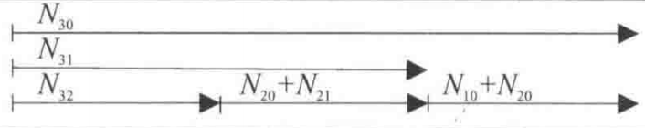
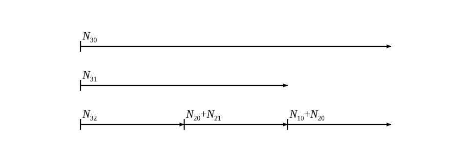

# 编组方案svg绘图

原图    
  
生成图  


## 绘图要求

> 仅保留线段、起点竖线标记、数学标注与底部站点编号 3/2/1/0； 
> 方案编号（方框 + 罗马数字）属原图标记，不在生成范围内。


<details>
<summary>展开 SVG 矢量源码</summary>

```xml
<svg xmlns="http://www.w3.org/2000/svg" viewBox="0 0 950 340" width="950" height="340">
  <defs>
    <marker id="ar" viewBox="0 0 10 10" refX="9.5" refY="5"
            markerWidth="10" markerHeight="10" markerUnits="userSpaceOnUse"
            orient="auto-start-reverse">
      <path d="M0,1.2 L10,5 L0,8.8 z" fill="#000"/>
    </marker>
  </defs>
  <rect x="0" y="0" width="950" height="340" fill="#ffffff"/>
  <line x1="165" y1="95" x2="801" y2="95" stroke="#000" stroke-width="2.2" marker-end="url(#ar)"/>
  <line x1="165" y1="84" x2="165" y2="106" stroke="#000" stroke-width="2.2"/>
  <text x="169" y="81" font-family="Times New Roman, Times, Liberation Serif, DejaVu Serif, serif" font-size="23" text-anchor="start" fill="#000"><tspan font-style="italic">N</tspan><tspan font-size="14" dy="5.5" font-style="normal">30</tspan><tspan dy="-5.5"> </tspan></text>
  <line x1="165" y1="175" x2="589" y2="175" stroke="#000" stroke-width="2.2" marker-end="url(#ar)"/>
  <line x1="165" y1="164" x2="165" y2="186" stroke="#000" stroke-width="2.2"/>
  <text x="169" y="161" font-family="Times New Roman, Times, Liberation Serif, DejaVu Serif, serif" font-size="23" text-anchor="start" fill="#000"><tspan font-style="italic">N</tspan><tspan font-size="14" dy="5.5" font-style="normal">31</tspan><tspan dy="-5.5"> </tspan></text>
  <line x1="165" y1="255" x2="377" y2="255" stroke="#000" stroke-width="2.2" marker-end="url(#ar)"/>
  <line x1="165" y1="244" x2="165" y2="266" stroke="#000" stroke-width="2.2"/>
  <text x="169" y="241" font-family="Times New Roman, Times, Liberation Serif, DejaVu Serif, serif" font-size="23" text-anchor="start" fill="#000"><tspan font-style="italic">N</tspan><tspan font-size="14" dy="5.5" font-style="normal">32</tspan><tspan dy="-5.5"> </tspan></text>
  <line x1="377" y1="255" x2="589" y2="255" stroke="#000" stroke-width="2.2" marker-end="url(#ar)"/>
  <line x1="377" y1="244" x2="377" y2="266" stroke="#000" stroke-width="2.2"/>
  <text x="381" y="241" font-family="Times New Roman, Times, Liberation Serif, DejaVu Serif, serif" font-size="23" text-anchor="start" fill="#000"><tspan font-style="italic">N</tspan><tspan font-size="14" dy="5.5" font-style="normal">20</tspan><tspan dy="-5.5"> </tspan><tspan font-style="normal">+</tspan><tspan font-style="italic">N</tspan><tspan font-size="14" dy="5.5" font-style="normal">21</tspan><tspan dy="-5.5"> </tspan></text>
  <line x1="589" y1="255" x2="801" y2="255" stroke="#000" stroke-width="2.2" marker-end="url(#ar)"/>
  <line x1="589" y1="244" x2="589" y2="266" stroke="#000" stroke-width="2.2"/>
  <text x="593" y="241" font-family="Times New Roman, Times, Liberation Serif, DejaVu Serif, serif" font-size="23" text-anchor="start" fill="#000"><tspan font-style="italic">N</tspan><tspan font-size="14" dy="5.5" font-style="normal">10</tspan><tspan dy="-5.5"> </tspan><tspan font-style="normal">+</tspan><tspan font-style="italic">N</tspan><tspan font-size="14" dy="5.5" font-style="normal">20</tspan><tspan dy="-5.5"> </tspan></text>
  <text x="165" y="285" font-family="Times New Roman, Times, Liberation Serif, DejaVu Serif, serif" font-size="23" text-anchor="middle" fill="#000">3</text>
  <text x="377" y="285" font-family="Times New Roman, Times, Liberation Serif, DejaVu Serif, serif" font-size="23" text-anchor="middle" fill="#000">2</text>
  <text x="589" y="285" font-family="Times New Roman, Times, Liberation Serif, DejaVu Serif, serif" font-size="23" text-anchor="middle" fill="#000">1</text>
  <text x="801" y="285" font-family="Times New Roman, Times, Liberation Serif, DejaVu Serif, serif" font-size="23" text-anchor="middle" fill="#000">0</text>
</svg>
```

</details>

---

## 结构解读

按「相邻车站开行的列车同线」规则，下方 3→2、2→1、1→0 三段构成主链；
上方两条为 3 站开行的跨站直达列车。

| 行 | 车流 | 径路 | 长度 | 类型 |
| --- | --- | --- | --- | --- |
| 0 | $N_{30}$ | 3 → 0 | 3 区段（最长） | 跨站直达 |
| 1 | $N_{31}$ | 3 → 1 | 2 区段 | 跨站直达 |
| 2 | $N_{32}$ | 3 → 2 | 1 区段 | 主链首段 |
| 2 | $N_{20}+N_{21}$ | 2 → 1 | 1 区段 | 主链中段 |
| 2 | $N_{10}+N_{20}$ | 1 → 0 | 1 区段 | 主链末段 |

> 注：主链上 $N_{20}$ 同时出现在 2→1 与 1→0 两段——它在 1 站通过、不改编。

## 代码验证结论

只需向 `SCHEMES` 追加一条：

```python
{"name": "example", "row_gap": 80, "lines": [
    {"row": 0, "from": 0, "to": 3, "terms": ("30",)},
    {"row": 1, "from": 0, "to": 2, "terms": ("31",)},
    {"row": 2, "from": 0, "to": 1, "terms": ("32",)},
    {"row": 2, "from": 1, "to": 2, "terms": ("20", "21")},
    {"row": 2, "from": 2, "to": 3, "terms": ("10", "20")},
]}
```

自检全部通过：3 条横线（行数正确）、5 个起点竖线标记、主链同线且连续、标注无重叠、内容未越界。
